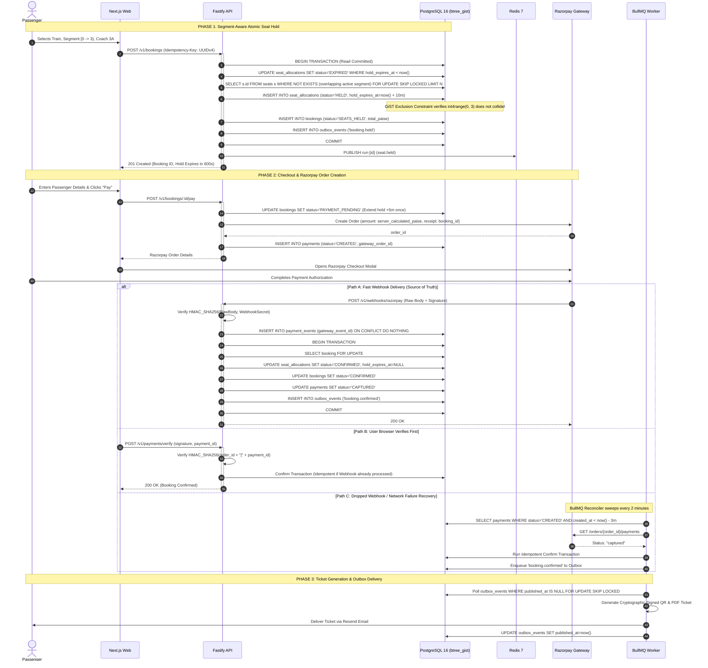

<div align="center">

# 🚆 RailGrid

### High-Concurrency, Zero-Double-Booking Rail Reservation & Live Telemetry Engine

[](https://www.typescriptlang.org/)
[](https://nextjs.org/)
[](https://www.fastify.io/)
[](https://www.postgresql.org/)
[](https://redis.io/)
[](https://bullmq.io/)
[](https://opensource.org/licenses/MIT)

<p align="center">
  <b>A portfolio-grade, production-shaped train ticket reservation platform engineered to survive real-world Tatkal-scale concurrency, eliminate phantom inventory, and guarantee mathematical zero double-booking under extreme load.</b>
</p>

---

</div>

## 📌 Executive Summary

Modern high-density railway systems—like Indian Railways (IRCTC)—process **tens of millions of booking requests daily**, characterized by catastrophic bursts such as the 10:00 AM / 11:00 AM Tatkal drop. During peak seconds, hundreds of thousands of users compete for a handful of berths across multi-stop journeys.

Conventional reservation architectures routinely buckle under this pressure:
1. **Application-level race conditions** cause phantom availability and catastrophic double-bookings.
2. **Naive seat allocation locks entire train routes**, stranding capacity because a passenger traveling from Station $A \to B$ blocks another passenger wanting the same physical seat from Station $B \to C$.
3. **Flaky payment webhooks, user disconnects, and late payment capture** result in orphaned deductions, lost inventory, or unresolvable financial reconciliation loops.
4. **Third-party telemetry outages** cascade across the frontend, freezing search and confirmation journeys.

**RailGrid** was built from the ground up to solve these fundamental distributed systems challenges. It combines **PostgreSQL mathematical exclusion constraints (`btree_gist`)**, **non-blocking row-level lock skipping (`SKIP LOCKED`)**, **cryptographic idempotency engines**, and a **fault-tolerant circuit-breaker external telemetry cache**—packaged in a retro-tactile split-flap departure board UI.

> [!NOTE]
> **Disclaimer:** RailGrid is an independent engineering showcase and educational system. It is **not affiliated with, endorsed by, or integrated with IRCTC or Indian Railways**. It utilizes sandboxed payment test keys and verified mock/fixture data.

---

## 🎯 The Core Problems RailGrid Solves

### 1. The Overlapping Journey Segment Concurrency Crisis
A train traveling from **New Delhi (Stop 0) $\to$ Kanpur (Stop 3) $\to$ Lucknow (Stop 5)** has distinct half-open journey segments $[from\_idx, to\_idx)$:
* **Passenger A** books $[0, 3)$ (Delhi $\to$ Kanpur).
* **Passenger B** wants $[3, 5)$ (Kanpur $\to$ Lucknow). **Both can share the exact same physical berth!**
* **Passenger C** wants $[0, 5)$ (Delhi $\to$ Lucknow). This overlaps with both and must be rejected.

Most traditional relational models either lock the seat for the entire journey (destroying seat utilization) or perform read-then-write checks in application code that fail under concurrent transactions.

**How RailGrid Solves It:**
RailGrid delegates segment validity to the PostgreSQL kernel using the **`btree_gist`** extension and continuous integer range exclusion constraints:
```sql
EXCLUDE USING gist (
  run_id WITH =,
  seat_id WITH =,
  int4range(from_idx, to_idx) WITH &&
) WHERE (status IN ('HELD', 'CONFIRMED'));
```
Even if application servers crash, race, or run out of memory, **PostgreSQL rejects conflicting overlapping segments at the storage engine level with error `23P01` (`exclusion_violation`)**, maintaining strict mathematical correctness.

---

### 2. Lock Contention & Deadlocks During Inventory Bursts
Under standard `SELECT ... FOR UPDATE` row locking, hundreds of concurrent buyers attempting to reserve seats in the same coach cause transaction pile-ups, lock contention spikes, and circular deadlocks.

**How RailGrid Solves It:**
* **`SKIP LOCKED` Selection:** Automatic seat assignment utilizes `FOR UPDATE OF s SKIP LOCKED` ordered deterministically by `seat.id`. Concurrent transactions smoothly claim adjacent unallocated seats without waiting in a blocking lock queue.
* **Deterministic Multi-Seat Sorting:** When passengers pick specific berths (e.g., family booking), IDs are sorted ascending prior to acquisition, mathematically eliminating AB-BA deadlocks.

---

### 3. Ghost Bookings & Lost Webhooks
When users pay via external payment gateways (e.g., Razorpay / Stripe), browsers disconnect, tabs close, and webhooks can be dropped or delivered out of order.
* If a webhook is lost, the user's money is deducted, but the booking remains stuck in `PENDING`.
* If a payment arrives *after* the 10-minute hold TTL expires, naive systems overwrite or re-allocate the seat, resulting in two passengers holding the same ticket.

**How RailGrid Solves It:**
* **Strict State Machines:** Enforces unidirectional transitions:
  $$\text{CREATED} \longrightarrow \text{SEATS\_HELD} \longrightarrow \text{PAYMENT\_PENDING} \longrightarrow \text{CONFIRMED} \;\big|\; \text{EXPIRED} \;\big|\; \text{CANCELLED}$$
* **Late-Payment Self-Healing:** If payment arrives after hold expiration, the system attempts to atomically re-acquire the seat; if already claimed by someone else, it automatically flags the payment as `REFUND_DUE` and queues an immediate refund.
* **Asynchronous Reconciler Worker:** A continuous BullMQ worker probes gateway order states every 2 minutes for any unresolved transaction older than 3 minutes, healing dropped webhooks automatically.

---

### 4. Telemetry Outages & Third-Party Thundering Herds
External train tracking providers (such as RailRadar or NTES APIs) impose strict rate limits (e.g., 100 requests/month sandbox limits) and experience frequent latency spikes.

**How RailGrid Solves It:**
* **Token-Checked Single-Flight Cache:** When a train's live status cache expires in Redis, a distributed token-checked mutex ensures that *only a single request* queries the external API, preventing cache stampedes.
* **Circuit Breakers with Stale Fallback:** An Opossum-based circuit breaker cuts failing network requests after consecutive timeouts, serving 24-hour last-known-good status with a transparent `stale: true` badge.
* **Rolling 30-Day Budget Quota Guard:** Reaches cache-only mode when 80% of third-party API quotas are reached, preventing catastrophic API exhaustion.

---

## 🏛️ System Architecture

```
                                  [ Users & Browsers ]
                                           │
                                    HTTPS / WSS / REST
                                           │
                             ┌─────────────▼─────────────┐
                             │ Cloudflare Edge / WAF     │
                             │ DDoS • Turnstile Captcha  │
                             └─────────────┬─────────────┘
                                           │
                     ┌─────────────────────┴─────────────────────┐
                     │                                           │
              Static & SSR Pages                          API & WebSockets
                     │                                           │
          ┌──────────▼──────────┐                     ┌──────────▼──────────┐
          │  Next.js 14 App     │                     │  Fastify API Node   │
          │  Tailwind + Radix   │                     │  Zod Type Provider  │
          │  Split-Flap Engine  │                     │  Sliding Rate Limit │
          └─────────────────────┘                     └──────────┬──────────┘
                                                                 │
                                     ┌───────────────────────────┼───────────────────────────┐
                                     │                           │                           │
                            ┌────────▼────────┐         ┌────────▼────────┐         ┌────────▼────────┐
                            │ PostgreSQL 16   │         │ Redis 7 (Cache) │         │ Redis 7 (Queue) │
                            │ Primary Node    │         │ Rate Limiting   │         │ BullMQ Storage  │
                            │ btree_gist GiST │         │ Pub/Sub Sockets │         │ No-Eviction     │
                            └────────┬────────┘         └─────────────────┘         └────────┬────────┘
                                     │                                                       │
                                     │ Outbox Pattern                                        │
                                     └───────────────────────────┐                           │
                                                                 │                           │
                                                      ┌──────────▼───────────────────────────▼┐
                                                      │           Worker Pool (BullMQ)        │
                                                      │  - Hold Expiry Sweeper (30s)          │
                                                      │  - Payment Reconciler (2m)            │
                                                      │  - Outbox Publisher (1s)              │
                                                      │  - Ticket PDF & QR Generator          │
                                                      └──────────────────┬────────────────────┘
                                                                         │
                                       ┌─────────────────────────────────┴─────────────────────────────────┐
                                       │                                 │                                 │
                              ┌────────▼────────┐               ┌────────▼────────┐               ┌────────▼────────┐
                              │  Razorpay API   │               │   RailRadar     │               │  Resend Email   │
                              │  Test Mode      │               │   Live Telemetry│               │  Transactional  │
                              └─────────────────┘               └─────────────────┘               └─────────────────┘
```

---

## 🔄 End-to-End Booking & Reconciliation Sequence

The sequence diagram below illustrates how RailGrid guarantees zero double-booking, manages atomic seat holds, and reconciles asynchronous payments:



---

## 🎨 Distinctive Visual Identity: The Split-Flap Departure Board

RailGrid departs from generic enterprise UI templates, adopting the **tactile aesthetics of vintage European & Indian mechanical railway signage**:

```
┌──────────────────────────────────────────────────────────────────────────────────┐
│  TRAIN NO. │ TRAIN NAME            │ FROM  │ TO    │ DEP   │ PLAT │ STATUS       │
│  [1][2][9] │ [R][A][J][D][H][A][N] │ [N][D]│ [B][C]│ 16:55 │  03  │ [ON TIME]    │
└──────────────────────────────────────────────────────────────────────────────────┘
```

* **3D Split-Flap Mechanical Boards:** Train numbers, timings, and platforms flip character-by-character using hardware-accelerated 3D CSS transforms (automatically fades for users with `prefers-reduced-motion`).
* **Journey Ribbon Route Scrubber:** Interactive metro-line representation of the entire train route. Users drag boarding and destination handles across stations, driving segment allocation indices $[from\_idx, to\_idx)$.
* **Segment-Aware Cutaway Coach Maps:** Top-down coach layout (1A, 2A, 3A, SL, CC) displaying live berth occupancy segments. Seats taken downstream but vacant for *your* journey display a distinct reusable berth indicator.
* **Perforated Ticket Stubs:** Tickets feature scalloped perforated edges, high-contrast typography, and dynamic barcode/QR stamps with one-click offline wallet downloads.
* **Burning Perforation Hold Timer:** A 10-minute hold countdown timer that visually burns along a ticket perforation, switching to urgent amber/red alert states in the final 60 seconds.

---

## 🛠️ Technology Stack Matrix

| Layer | Technology | Rationale & Responsibility |
|---|---|---|
| **Monorepo** | **pnpm Workspaces + Turborepo** | Blazing-fast dependency caching, unified package versioning, and atomic script orchestration. |
| **Backend API** | **Fastify 4.x + Node 20+** | Low-overhead, high-throughput asynchronous HTTP & WebSocket engine with zero startup bloat. |
| **Validation** | **Zod + Fastify Type Provider** | End-to-end type safety spanning API contracts, environment variables, and client forms. |
| **Database & ORM** | **PostgreSQL 16 + Prisma** | Prisma handles basic relational types; hand-crafted raw SQL migrations manage `btree_gist` GiST exclusion constraints. |
| **Caching & Pub/Sub** | **Redis 7 (LRU Cache)** | Sliding-window rate limiters, token-checked single-flight cache mutexes, and real-time seat change fanout. |
| **Queue & Scheduling** | **Redis 7 (No-Eviction) + BullMQ** | Reliable background workers for outbox dispatch, hold expiration sweeps, and payment reconciliation. |
| **Frontend** | **Next.js 14 (App Router)** | Server Components, optimized client hydration, Tailwind CSS, Framer Motion, and TanStack Query. |
| **Security & Auth** | **Argon2id + JWT + Opaque Refresh** | OWASP-compliant password hashing, rotating refresh tokens with family reuse detection, and CSRF Origin validation. |
| **Payments** | **Razorpay Test Mode** | Webhook signature verification on raw payloads with atomic reconciliation pipelines. |
| **Testing** | **Vitest + Playwright + k6** | Unit tests for state machines, Testcontainers for Postgres/Redis integration, and k6 for 1,000-VU concurrency verification. |

---

## 📂 Repository Directory Layout

```
railgrid/
├── apps/
│   ├── api/                     # Fastify REST & WebSocket server (Stateless)
│   │   ├── src/
│   │   │   ├── plugins/         # Error handler, request-id, rate-limiter, auth
│   │   │   ├── routes/          # Health, metrics, auth, trains, bookings, payments
│   │   │   └── train-data/      # RailRadar provider, circuit breakers, cache guards
│   ├── web/                     # Next.js 14 frontend application
│   │   ├── src/app/             # App router pages (Search, Coach Map, Checkout, Ticket)
│   │   └── src/components/      # Split-flap board, Journey Ribbon, Coach cutaway
│   └── worker/                  # BullMQ background workers (Outbox, Sweeper, Reconciler)
├── packages/
│   ├── shared/                  # Zod schemas, state machines, types, error constants
│   └── db/                      # Prisma schema, SQL migrations, seed fixtures
├── infra/
│   ├── docker/                  # Dockerfiles for API, Worker, and DB initialization
│   └── docker-compose.yml       # Local PostgreSQL 16 (btree_gist) + Redis 7 instances
├── docs/                        # Architecture, Design Problem Register, Runbooks
├── tests/                       # k6 load scripts and chaos recovery scenarios
├── agent.md                     # Comprehensive technical specification & protocol
└── PROGRESS.md                  # Phase-by-phase implementation log
```

---

## 🚀 Quick Start Guide

### Prerequisites
* **Node.js**: `v20.x` or higher
* **pnpm**: `v9.x` (`corepack enable pnpm`)
* **Docker & Docker Compose**: For local PostgreSQL and Redis instances

### 1. Clone & Install Dependencies
```bash
git clone https://github.com/your-username/railgrid.git
cd railgrid
pnpm install
```

### 2. Configure Environment Variables
Copy `.env.example` to `.env`:
```bash
cp .env.example .env
```
Ensure required secrets are configured (local defaults are provided for database, redis, and auth keys).

### 3. Start Infrastructure Services
Launch PostgreSQL (with `btree_gist`) and dual Redis instances:
```bash
docker compose -f infra/docker-compose.yml up -d
```

### 4. Run Migrations & Seed Database
Apply raw SQL migrations and generate Prisma clients:
```bash
# Generate Prisma Client
pnpm --filter @railgrid/db db:generate

# Deploy Migrations (includes btree_gist GiST constraints)
pnpm --filter @railgrid/db db:migrate

# Seed 23 Stations, 15 Trains, Coach layouts, Fare rules, and 60-day Runs
pnpm --filter @railgrid/db db:seed
```

### 5. Launch the Development Environment
Run all workspaces concurrently via Turborepo:
```bash
pnpm dev
```
* **Frontend Application:** [http://localhost:3000](http://localhost:3000)
* **Fastify API Server:** [http://localhost:4000](http://localhost:4000)
* **Liveness & Readiness:** `GET http://localhost:4000/health` | `GET http://localhost:4000/ready`
* **Prometheus Metrics:** `GET http://localhost:4000/metrics`

---

## 🧪 Verification & Concurrency Testing

### Unit & Integration Tests
```bash
# Run unit tests across all packages
pnpm test

# Run isolated integration tests against PostgreSQL & Redis
pnpm --filter @railgrid/api test
```

### Proving Zero Double-Bookings (Exclusion Constraint Check)
Run the verification script to verify that overlapping segment bookings are strictly rejected:
```bash
pnpm --filter @railgrid/db prisma db execute --file prisma/verify-segment-constraint.sql
```
* ✅ Adjacent half-open segments $[0, 3)$ and $[3, 5)$ **succeed** on the same seat.
* ❌ Overlapping segment $[2, 4)$ on the same seat is **immediately rejected with error `23P01`**.

---

## 🛡️ Security & Resilience

* **Argon2id Password Storage:** Evaluated with OWASP-recommended parameters ($m=19\text{ MiB}, t=2, p=1$).
* **Refresh Token Rotation:** Employs cryptographically secure token family tracking. Reusing an old refresh token automatically invalidates all active sessions across the entire token family.
* **Sliding-Window Rate Limiting:** Powered by atomic Redis Lua scripts with IP + email hashing, protecting authentication routes against dictionary attacks.
* **Strict Idempotency Middleware:** Guarantees that duplicate requests with identical `Idempotency-Key` headers never process twice or trigger duplicate payment authorizations.
* **Zero PII Exposure:** Payment identifiers are masked; raw credit card or banking details never touch RailGrid servers (handled strictly by Razorpay PCI-DSS compliant modals).

---

## 📄 License

This project is licensed under the terms of the **MIT License**.

```
MIT License

Copyright (c) 2026 RailGrid Contributors

Permission is hereby granted, free of charge, to any person obtaining a copy
of this software and associated documentation files (the "Software"), to deal
in the Software without restriction, including without limitation the rights
to use, copy, modify, merge, publish, distribute, sublicense, and/or sell
copies of the Software, and to permit persons to whom the Software is
furnished to do so, subject to the following conditions:

The above copyright notice and this permission notice shall be included in all
copies or substantial portions of the Software.

THE SOFTWARE IS PROVIDED "AS IS", WITHOUT WARRANTY OF ANY KIND, EXPRESS OR
IMPLIED, INCLUDING BUT NOT LIMITED TO THE WARRANTIES OF MERCHANTABILITY,
FITNESS FOR A PARTICULAR PURPOSE AND NONINFRINGEMENT. IN NO EVENT SHALL THE
AUTHORS OR COPYRIGHT HOLDERS BE LIABLE FOR ANY CLAIM, DAMAGES OR OTHER
LIABILITY, WHETHER IN AN ACTION OF CONTRACT, TORT OR OTHERWISE, ARISING FROM,
OUT OF OR IN CONNECTION WITH THE SOFTWARE OR THE USE OR OTHER DEALINGS IN THE
SOFTWARE.
```

---

<div align="center">
  <sub>Built with precision for high-concurrency distributed systems engineering.</sub>
</div>

